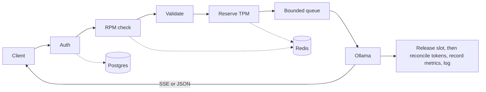

# gateway-scratch

An LLM gateway in TypeScript that sits in front of [Ollama](https://ollama.com). It exposes a subset of the OpenAI chat completions API and adds API keys, per-key request and token limits, admission control for a limited GPU, cancellation, Prometheus metrics and request logging.

**Status:** work in progress, not production-ready. Read [Known issues](#known-issues) before exposing it.

## Features

- Streaming (SSE, the default) and non-streaming chat completions
- Bearer API keys, stored in Postgres as SHA-256 hashes
- Per-key **requests/min** (sliding-window log) and **tokens/min** (token bucket), each atomic in a Redis Lua script
- Bounded FIFO queue in front of the model, with a wait timeout
- Client disconnects cancel queued requests and abort upstream calls
- Prometheus metrics, liveness and readiness endpoints, per-request logs in Postgres

## Architecture



| State | Location | Scope |
|---|---|---|
| API keys, request logs | Postgres (pool of 20) | Shared |
| RPM and TPM counters | Redis | Shared |
| Queue and concurrency slots | Process memory | **Per gateway instance** |

With N replicas, up to `N × GPU_MAX_CONCURRENCY` requests can reach the backend.

## Quickstart

**Prerequisites:** Node.js (tested on 22.23.5), Docker, and Ollama with a model pulled.

```bash
git clone https://github.com/abhishek1543748/gateway-scratch.git
cd gateway-scratch
npm ci
docker compose up -d                                   # Postgres only
docker run -d -p 6379:6379 redis:7-alpine              # Redis is not in the compose file
touch .env                                             # `npm run dev` requires this file
npm run dev
```

In a second terminal, once the gateway is listening:

```bash
npx tsx scripts/gen-key.ts my-client 60 20000          # name, RPM, TPM; prints the key first
export KEY=sk-live-...

curl -N http://localhost:3000/v1/chat/completions \
  -H "Authorization: Bearer $KEY" -H 'Content-Type: application/json' \
  -d '{"model":"<your-ollama-model>","messages":[{"role":"user","content":"Hello"}]}'
```

`gen-key.ts` does not load `.env`; export any `PG_*` overrides in your shell. The compose password is for local development only.

## Configuration

| Variable | Default | Effect |
|---|---|---|
| `PORT` | `3000` | Listen port |
| `OLLAMA_BASE_URL` | `http://127.0.0.1:11434` | Backend |
| `REDIS_URL` | `redis://127.0.0.1:6379` | Rate-limit store |
| `PG_HOST` / `PG_PORT` | `localhost` / `5432` | Postgres address |
| `PG_USER` / `PG_PASSWORD` | `postgres` / `password` | Postgres credentials |
| `PG_DATABASE` | `llm_gateway` | Database name |
| `GPU_MAX_CONCURRENCY` | `2` | Concurrent upstream requests per instance |
| `QUEUE_MAX_DEPTH` | `20` | Maximum waiting requests |
| `QUEUE_TIMEOUT_MS` | `20000` | Maximum queue wait |
| `RATE_LIMIT_FAIL_OPEN` | `true` | Any value except `false` admits requests when Redis calls fail |
| `METRICS_TOKEN` | empty (public) | Meant to protect `/metrics`; **currently broken** |

Tables are created at startup. New keys default to 60 RPM and 20,000 TPM.

## API

| Endpoint | Auth | Purpose |
|---|---|---|
| `POST /v1/chat/completions` | API key | Chat completion |
| `GET /v1/models` | API key | Model list from Ollama (not rate limited) |
| `GET /livez` | None | Process is up |
| `GET /healthz` | None | 503 if Ollama is unreachable; also reports Redis and queue state. Ollama check times out after 3 s |
| `GET /metrics` | See above | Prometheus format |

| Request field | Rules |
|---|---|
| `model` | Required, non-empty |
| `messages` | At least one; role `system`, `user` or `assistant`; string content of 1 to 10,000 characters |
| `stream` | Default `true` |
| `max_tokens` | 1 to 1024, default 256 |
| `temperature` | 0 to 2, default 1 |

The JSON body limit is 1 MB. This is not full OpenAI compatibility: array content and the `tool` role are rejected, and other top-level fields such as `top_p`, `stop` and `tools` are silently dropped. Streaming requests ask Ollama to include usage, which is passed on to the client.

| Status | Meaning |
|---|---|
| 400 | Invalid body, or estimated tokens exceed the key's whole per-minute budget |
| 401 | Missing, invalid or inactive key |
| 429 | RPM or TPM exhausted; includes `Retry-After` |
| 502 | Failure talking to Ollama before the response started |
| 503 | Queue full or timed out (`Retry-After: 5`), or Redis down with fail-open off |
| 500 | Database error during auth, or unexpected queue error |
| 499 | Recorded in metrics and logs when the client disconnects |

Ollama's own error statuses are passed through for chat completions.

## Benchmarks

These measure **the gateway, not a model**. The backend is a fake Ollama that sends 20 chunks about 10 ms apart. No GPU or real inference was involved.

**Setup:** commit `c83e512`; 2 vCPUs (Intel Xeon @ 2.10 GHz), 7 GB RAM; Node 22.23.5 with `tsx`; Postgres 16 and Redis on the same host. The load generator and fake backend shared those CPUs. `GPU_MAX_CONCURRENCY=1000` keeps queueing out of the overhead test; key limits were set high. Closed-loop load, 3 runs per cell, 200 / 1,000 / 2,000 requests per run at concurrency 1 / 8 / 32. Each value is the **median across the 3 runs**. All requests in these runs returned 200.

TTFT here is client-side time to the first response body chunk. Latencies are in ms.

| Concurrency | Path | Req/s | TTFT p50 | TTFT p99 | Total p50 | Total p99 |
|---:|---|---:|---:|---:|---:|---:|
| 1 | Direct | 4.7 | 11.5 | 14.2 | 214.4 | 218.0 |
| 1 | Gateway | 4.6 | 14.3 | 26.2 | 217.2 | 226.5 |
| 8 | Direct | 37.2 | 11.2 | 16.9 | 214.3 | 224.4 |
| 8 | Gateway | 36.6 | 13.6 | 31.4 | 217.0 | 233.9 |
| 32 | Direct | 146.0 | 11.4 | 40.9 | 216.0 | 241.7 |
| 32 | Gateway | 142.0 | 14.0 | 111.7 | 219.2 | 323.1 |

- **Median cost:** p50 TTFT was 2.4 to 2.8 ms higher through the gateway.
- **Tail cost:** at concurrency 32, the gateway's p99 TTFT was 70.8 ms higher and p99 total 81.4 ms higher. The cause has not been profiled. These are differences between percentiles, not per-request overhead.
- **Not measured:** saturation throughput. Request rate here is bounded by concurrency and the fake backend's delay. With 200 requests per run, p99 at concurrency 1 is based on very few samples.

To reproduce, start the fake backend with `N=20 GAP=10 node bench/mock-ollama.mjs` (port 11434, so stop Ollama first). Start the gateway with `GPU_MAX_CONCURRENCY=1000`, create a key with high limits, export it as `KEY`, then run `bash bench/bench.sh`. The recorded runs followed a 200-request warm-up.

### Admission control and limits

| Test | Result |
|---|---|
| 40 simultaneous requests, 2 slots, depth 20, about 1 s service | 22 succeeded, 18 got 503; backend peak concurrency was 2; successful p99 total 11.8 s |
| 6 requests, 2 slots, about 15 s service, 20 s queue timeout | 2 finished at about 15.8 s, 2 got 503 at 20.1 s, 2 finished at about 31.6 s |
| 100 concurrent, RPM limit 10 | 10 succeeded, 90 got 429 |
| 100 concurrent, TPM limit 1,000, 109 tokens reserved each | 9 succeeded (981 reserved), 91 got 429 |

These ran against the fake backend. The limit tests used one gateway instance.

### Redis outage

Sequential requests, about 1 s fake generation, Redis shut down while the gateway was running. Three samples per row.

| State | Status | Time to first byte |
|---|---|---|
| Healthy | 200 | about 54 ms |
| Down, fail-open (default) | 200 | 3.10 s, 6.76 s, 9.99 s |
| Down, fail-closed | 503 | 0.31 s, 2.69 s, 3.50 s |

Fail-open preserves availability but **not latency**. Requests wait for Redis calls to fail before continuing. A likely cause is `ioredis` retries (`maxRetriesPerRequest: 3`, growing reconnect delay), with up to two limiter calls per admitted request. A shorter command timeout or a circuit breaker is the thing to test. `/healthz` also took 4.3 to 5.6 s, because its Redis ping has no deadline of its own.

## Design decisions and tradeoffs

The choices below are in the code. The costs and alternatives are engineering analysis; the alternatives were not benchmarked and may not have been tried.

### Sliding-window log for RPM
- **Gain:** enforces the limit over a rolling 60 s, without the boundary burst of a fixed window. Rejected requests are not recorded, so retrying doesn't extend the block.
- **Cost:** memory grows with the limit, up to one sorted-set entry per admitted request per key. A counter or token bucket would be smaller but less exact or burstier.
- **Note:** RPM is counted before validation and the TPM check, so requests rejected by either still use RPM.

### Token bucket with reserve and reconcile for TPM
- **How:** reserves `estimated prompt + max_tokens`, then adjusts toward actual usage after the request. The estimate is `ceil(chars / 4) + 4` per message, plus 3.
- **Gain:** concurrent requests cannot all spend the same budget before any usage is known.
- **Cost:** capacity is held for output that may never be generated, so a large `max_tokens` can cause early 429s. The character estimate is not a tokenizer. Debt is capped at one bucket.
- **Refill:** capacity / 60 per second. This allows a full bucket as a burst plus ongoing refill, so it is not a strict rolling-minute cap.
- **Atomicity:** each script is atomic, but RPM, TPM and reconciliation are not one transaction. Reconciliation is fire-and-forget; if it fails, it is not retried.

### Fail-open rate limiting by default
- **Gain:** a Redis outage doesn't by itself reject traffic.
- **Cost:** while limiter calls fail, those limits are not enforced, and latency rose to seconds in the test above.

### In-process bounded queue
- **Gain:** simple FIFO with no extra network hop; sheds load instead of growing without limit; abandoned requests leave the queue.
- **Cost:** not shared between replicas, lost on restart, no priority or per-key fairness. One key can fill it within its limits.
- **Sizing:** with 2 steady slots, clearing 20 waiting requests within 20 s needs service times of about 2 s or less. With longer generations, the timeout rejects requests before the depth setting is useful.

### Parse SSE lines instead of counting network chunks
- **Context:** commit `b4bb3c8` replaced chunk-based counting. A network chunk can hold part of an event or several events.
- **Gain:** buffers partial lines and uses Ollama's reported usage when present. Original bytes are still forwarded.
- **Cost:** every streamed event is also decoded and JSON-parsed. This cost wasn't isolated. Without usage data, counting content-bearing events is only an approximation. Multi-line SSE data isn't supported.

### Cancel on response close
- **Gain:** a disconnect removes a queued request or aborts the upstream call. In a mid-generation test, the fake backend saw the abort. Whether real GPU work stops depends on Ollama.
- **Accounting cost:** a cancelled stream is charged from the prompt estimate and counted events when final usage hasn't arrived. A non-streaming request cancelled before upstream headers arrive is logged as 0 tokens and its reservation refunded, even if the backend had started work.

### Database auth on each request, asynchronous logging
- **Auth:** deactivation applies to the next request and there is no cache to invalidate. The cost is a Postgres lookup per request, including requests with invalid keys, which happen before any rate limit.
- **Logging:** the response doesn't wait for the insert. Logs can be lost on a crash or database error; there is no retry or durable buffer.

## Observability

| Metric | Type | Labels |
|---|---|---|
| `llm_ttft_seconds` | Histogram | `model`, `api_key` |
| `llm_request_duration_seconds` | Histogram | `model`, `status_code` |
| `llm_queue_wait_seconds` | Histogram | None in practice (two are declared but never set) |
| `llm_tokens_generated_total` | Counter (prompt and completion, despite the name) | `model`, `api_key`, `type` |
| `llm_rate_limited_total` | Counter | `type` |
| `llm_http_requests_total` | Counter | `method`, `route`, `status_code` |
| `llm_queue_waiting_requests`, `llm_queue_active_slots`, `llm_queue_max_slots`, `llm_queue_max_depth` | Gauges | None |

Default Node.js process metrics are included. The internal TTFT and duration timers start **after auth and the RPM check**, so they under-report client latency, especially during a Redis outage. The `api_key` label is the key's name, which need not be unique. Successful model names become labels, so watch cardinality.

## Known issues

Marked **Reproduced** (seen when run) or **Code review** (not separately tested).

| Priority | Issue | Evidence |
|---|---|---|
| High | `/metrics` auth compares against the literal `$(config.metricsToken)` (should be `${...}`). The real token gets 401 and the publicly visible literal gets 200 | Reproduced |
| High | Stopping Postgres crashed the idle gateway with an unhandled `error` event. The `pg` pool has no `error` listener | Reproduced |
| High | `promptTokens` reads `completion_tokens`: backend reported 11 prompt and 20 completion; logs showed 20 and 20. This corrupts token logs, metrics and TPM charges | Reproduced |
| High | With Redis down, fail-open requests waited seconds | Reproduced |
| High | Generation has no upstream timeout, so a hung backend can hold a slot while the client stays connected. `/v1/models` also has no timeout and doesn't preserve upstream status | Code review |
| Medium | `res.write()` backpressure is ignored, so slow clients can increase memory use | Code review |
| Medium | The disconnect listener is attached after auth and limiter awaits, so an earlier disconnect may be missed | Code review |
| Low | `npx tsc --noEmit` reports 16 errors; `tsx` runs the code without type-checking | Reproduced |

## Testing

There is no automated test suite yet (`npm test` exits with an error). The results above came from manual and load tests against a fake backend. The Docker quickstart and a real Ollama backend were **not** tested as part of them.

## Project structure

```text
src/
  server.ts              routes and request lifecycle
  config.ts, schemas.ts  settings and request validation
  infra/                 Postgres and Redis clients
  middleware/            authentication and rate limiting
  services/              queue and SSE parser
  observability/         Prometheus metrics
scripts/gen-key.ts       API key creation
bench/                   fake backend and load scripts
```

## Roadmap

Suggested order:

1. Fix metrics auth, prompt token accounting and the Postgres crash
2. Add upstream timeouts, bound Redis outage latency and handle backpressure
3. Add tests for the queue, SSE parser and limiters; make type-checking pass in CI
4. Benchmark a real model on recorded GPU hardware
5. If running replicas, add shared admission control

## Contributing

Open an issue to discuss a change before sending a pull request. Include how you tested it.

## License

No license file is included yet, so no open-source reuse permission is granted by this repository.
